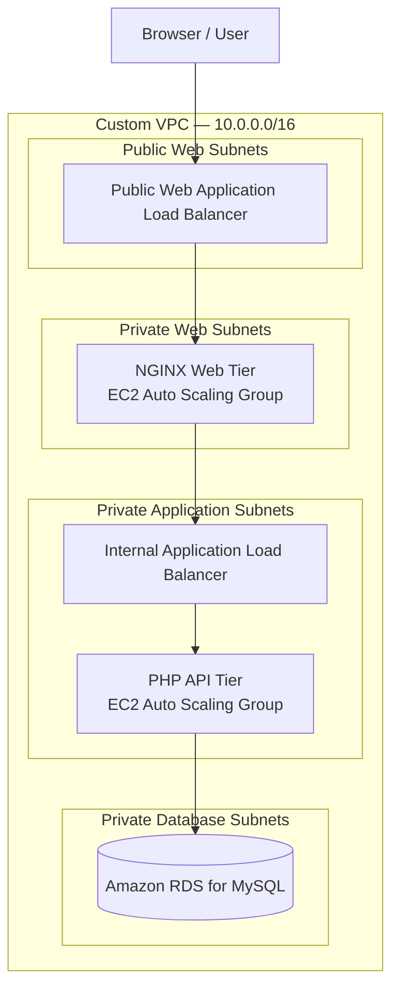

# ☁️ AWS Three-Tier Web Application - CloudNotes

> A learning  adapting a PHP/MySQL message board with a redesigned frontend and an AWS three-tier deployment plan.

CloudNotes is a small message-board application used to practise **AWS networking, three-tier architecture, load balancing, EC2 Auto Scaling, and database connectivity**. The frontend is redesigned while the reference project's PHP API and MySQL schema are retained. AWS components are documented as planned until they have been deployed and verified in the target account.

## 🎯 Project Scope

- **Customize the frontend:** redesign `frontend/index.html` and `frontend/styles.css` as a responsive CloudNotes interface.
- **Preserve the application contract:** keep the existing PHP API endpoints and database schema unchanged unless a verified deployment issue requires an adjustment.
- **Build the AWS network:** configure a custom VPC, subnets, route tables, and security groups.
- **Plan for availability:** deploy load balancers and EC2 Auto Scaling Groups across Availability Zones as the implementation progresses.
- **Document evidence:** maintain an architecture diagram, test results, screenshots, and troubleshooting notes.

## 🏗️ Target Architecture



**Traffic flow:** Browser → public web load balancer → NGINX frontend → application load balancer → PHP API → MySQL database.

- Allow public inbound traffic only at the intended public entry point.
- Restrict tier-to-tier access with security-group references and required ports.
- Keep the database in private subnets and allow database traffic only from the application tier.
- Configure private-subnet egress only when required; private subnets do not gain internet access automatically.
- Update this diagram if the deployed architecture differs from the target design.

## 🧰 Technology Stack

| Area | Technology | Role |
|---|---|---|
| Frontend | HTML, CSS, JavaScript | Render messages and submit new notes |
| Web tier | NGINX | Serve frontend assets and proxy API requests as configured |
| Application tier | PHP | Handle message API requests |
| Database | MySQL / Amazon RDS for MySQL | Persist messages |
| Networking | Amazon VPC, subnets, route tables, security groups, Internet Gateway | Isolate tiers and control traffic |
| Compute and traffic distribution | Amazon EC2, Application Load Balancer, Auto Scaling | Host and distribute web and application workloads |
| Operations | AWS CLI, shell commands, Git | Inspect and validate AWS resources and changes |

**Infrastructure-as-code note:** This README does not claim Terraform, CloudFormation, or a CI/CD pipeline is implemented. Add those technologies to the project description only after their configuration is committed and tested.

## 🌐 Planned Network Layout

The current plan uses `us-east-1` and a VPC CIDR of `10.0.0.0/16`. Confirm Availability Zone availability and subnet CIDR conflicts before provisioning resources.

| Tier | AZ A — `us-east-1a` | AZ B — `us-east-1b` | AZ C — `us-east-1c` |
|---|---|---|---|
| Public web | `10.0.0.0/20` | `10.0.16.0/20` | `10.0.32.0/20` |
| Private web | `10.0.48.0/20` | `10.0.64.0/20` | `10.0.80.0/20` |
| Private application | `10.0.96.0/20` | `10.0.112.0/20` | `10.0.128.0/20` |
| Private database | `10.0.144.0/20` | `10.0.160.0/20` | `10.0.176.0/20` |

### Route-table intent

- **Public web:** associate the shared public route table with all three public web subnets; add `0.0.0.0/0` to the existing Internet Gateway after verifying the gateway is attached to this VPC.
- **Private web, application, and database:** use separate route tables per Availability Zone as planned. Keep only the VPC-local route until a specific private egress requirement is implemented.
- **NAT Gateway:** do not claim NAT-based egress until a NAT Gateway exists and the relevant private routes are configured.

## 🗂️ Repository Layout

Keep this structure aligned with the files actually committed to the repository. Add directories as their implementation is ready.

```text
aws-three-tier-web-app/
├── README.md
├── frontend/
│   ├── index.html
│   └── styles.css
├── backend/
│   └── api/
│       ├── get_messages.php
│       ├── save_message.php
│       └── db_connection.php
├── database/
│   └── database_setup.sql
├── infrastructure/
│   ├── frontend_server.md
│   ├── backend_server.md
│   └── nginx_config
├── scripts/                 # Add validated AWS CLI scripts here
├── architecture/            # Add the finalized diagram here
└── screenshots/             # Add verified project evidence here
```

## 🚀 Prerequisites

- An AWS account in which the required services are available.
- AWS CLI v2 installed and configured with credentials for the intended account.
- IAM permissions scoped to the resources being created or inspected, including relevant VPC/EC2, Elastic Load Balancing, Auto Scaling, RDS, and `iam:PassRole` permissions where required.
- Git and a Bash-compatible shell for repository and command-line workflows.
- A browser for frontend verification.
- PHP and MySQL for local application testing, or the configured web/application/database services for deployed testing.

### Steps

1. Create VPC
2. Create subnets
    1. Web Public 1a, 1b, 1c
    2. Web Private 1a, 1b, 1c
    3. App Private 1a, 1b, 1c
    4. Db Private 1a, 1b, 1c
3. Create route tables
    1. Web Public
    2. Web Private 1a, 1b, 1c
    3. App Private 1a, 1b, 1c
    4. Db Private 1a, 1b, 1c
4. Associate route tables with subnet
5. Create internet Gateway (IGW)
    1. Attach it to VPC
6. Create NAT gateway (NATGW) in web public subnet
7. Add IGW and NAT routes in route table
    1. Public -> IGW
    2. Private -> NAT
8. Create security groups
    1. Frontend ALB
    2. Frontend Servers
    3. Backend ALB
    4. Backend Servers
    5. Db Private Servers
9. Create database subnet group
10. Create database server
11. Create Frontend ALB
    1. Create Frontend ALB target group 
12. Create Backend ALB
    1. Create Backend ALB target group
13. Create Frontend Server AMI
    1. Install Nginx
    2. Install Git
14. Create Backend Server AMI
    1. Install PHP, MySQL, Apache
    2. Install Git
    3. Run the database script
15. Create the Launch Template for Frontend Server
16. Create the Launch Template for Backend Server
17. Create the Auto Scaling Group for Frontend Server
18. Create the Auto Scaling Group for Backend Server


## ⚙️ Configuration Reference

The following values describe the current network plan. They are not credentials and may need adjustment for the AWS account.

| Setting | Planned value | Purpose |
|---|---|---|
| `REGION` | `us-east-1` | AWS region used by AWS CLI commands |
| `VPC_CIDR` | `10.0.0.0/16` | Address range for the VPC |
| `AZ_A` | `us-east-1a` | Planned Availability Zone A |
| `AZ_B` | `us-east-1b` | Planned Availability Zone B |
| `AZ_C` | `us-east-1c` | Planned Availability Zone C |
| `VPC_ID` | Set after VPC verification | ID of the VPC being inspected or changed |
| Database endpoint and credentials | Configure in the deployment environment | Used by the PHP database connection; never commit secrets |

Use the database setting names and delivery method supported by the retained `db_connection.php` and deployment configuration. Do not assume environment-variable support unless the code explicitly reads those variables.

## 🛠️ Deployment Runbook

Perform the steps in order. Confirm each resource in AWS before moving to the next stage.

### 1. Verify AWS identity and region

```bash
aws --version
aws sts get-caller-identity
aws configure get region
```

Set the region explicitly for validation commands:

```bash
export AWS_REGION="us-east-1"
```

### 2. Inspect the VPC and subnets

Set `VPC_ID` to the verified ID of the VPC created for this project. Do not copy an ID from another region or environment.

```bash
export VPC_ID="vpc-REPLACE_WITH_VERIFIED_ID"

aws ec2 describe-vpcs \
  --region "$AWS_REGION" \
  --vpc-ids "$VPC_ID" \
  --query 'Vpcs[0].{VpcId:VpcId,CidrBlock:CidrBlock,State:State}' \
  --output table

aws ec2 describe-subnets \
  --region "$AWS_REGION" \
  --filters "Name=vpc-id,Values=$VPC_ID" \
  --query 'Subnets[].{SubnetId:SubnetId,AZ:AvailabilityZone,CIDR:CidrBlock,State:State}' \
  --output table
```

### 3. Validate route tables

```bash
aws ec2 describe-route-tables \
  --region "$AWS_REGION" \
  --filters "Name=vpc-id,Values=$VPC_ID" \
  --query 'RouteTables[].{RouteTableId:RouteTableId,Routes:Routes,Associations:Associations[].SubnetId}' \
  --output json
```

- Confirm the public route table has a default route to the Internet Gateway attached to this VPC.
- Confirm each subnet is associated with its intended route table.
- Confirm private route tables do not expose unintended internet routes.
- Review the output before changing or deleting any route or association.

### 4. Configure security and application tiers

- Create tier-specific security groups with only the necessary inbound and outbound rules.
- Configure the web tier to serve the frontend and forward `/api/` traffic to the correct application endpoint.
- Configure the PHP API to use the intended database endpoint and credentials through the deployment configuration.
- Create the database subnet group and deploy MySQL/RDS into private database subnets.
- Configure launch templates, target groups, load balancers, and Auto Scaling Groups only after the relevant subnet and security-group configuration is verified.

### 5. Test the deployed API

Replace the placeholder with the actual web endpoint. Run these commands only after DNS, routing, and application deployment are configured.

```bash
export WEB_ENDPOINT="http://REPLACE_WITH_WEB_ENDPOINT"

curl -i "$WEB_ENDPOINT/api/get_messages.php"

curl -i -X POST \
  -H 'Content-Type: application/x-www-form-urlencoded' \
  --data-urlencode 'message=CloudNotes deployment verification' \
  "$WEB_ENDPOINT/api/save_message.php"
```

- Confirm the GET request returns valid JSON with `success` and `messages` when successful.
- Confirm the POST request returns a successful response.
- Reload the message list and verify the submitted note persists.
- Use HTTPS after TLS is configured for the public endpoint.


## 🔍 Troubleshooting and Recovery

| Symptom | Checks and recovery actions |
|---|---|
| Frontend loads but API returns `404` | Verify the deployed document root, `/api/` proxy configuration, and endpoint paths. |
| API returns `502` or `504` | Check target health, security-group rules, backend service status, NGINX configuration, and application logs. |
| API response is not valid JSON | Inspect PHP/application logs and ensure warnings or debug output are not printed before JSON. Do not expose secrets in error output. |
| Database connection fails | Verify the database endpoint, database credentials, database security group, port, and subnet placement. Allow database traffic only from the intended application tier. |
| A subnet has the wrong route table | Inspect associations before changing them; associate the subnet with the intended table and verify the result. |
| AWS CLI reports `UnauthorizedOperation` | Confirm the active account and identity, then request only the missing permissions required for the task. |
| A resource cannot be deleted | Inspect dependencies first. Remove dependent resources deliberately; do not repeatedly delete the VPC or shared resources without reviewing dependencies. |

For Amazon Linux 2023 instances, inspect service status and logs with commands such as `sudo systemctl status nginx`, `sudo journalctl -u nginx`, and `sudo systemctl status httpd` where those services are installed.

## 🔐 Security and Cost Notes

- Store secrets outside source control; exclude `.env`, private keys, credentials files, and logs containing secrets in `.gitignore`.
- Restrict SSH and database ports instead of allowing access from `0.0.0.0/0`.
- Keep RDS private and limit database access to the application tier.
- Validate IAM permissions before execution and avoid committing AWS credentials.
- Review AWS pricing before provisioning EC2, load balancers, NAT Gateways, and RDS. These resources can incur charges while running.
- During cleanup, identify project-owned resources and dependencies first. Delete only resources that are safe to remove and verify the final state in AWS.

## 🙌 Attribution

The application and infrastructure approach are adapted from the [original three-tier architecture sample](https://github.com/ajitinamdar-tech/three-tier-architecture-aws). The portfolio contribution is the CloudNotes frontend customization, AWS implementation work, validation, and project documentation completed in this repository. Review and preserve the applicable license terms and notices from the source project before redistributing its files.
